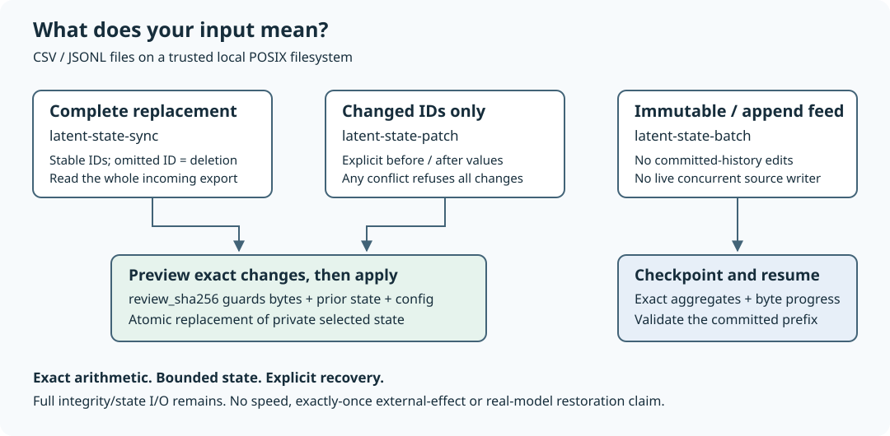

# Latent State Lab

**Keep what a computation needs to continue—not merely a description of what it did.**

This repository has two deliberately separate tracks. The stable V1 tools maintain exact aggregates over bounded local files. The experimental track studies restoration of an **untrained** attention computation. The first is usable developer software; the second is not pretrained latent reasoning.

| Your goal | Start here | What is not claimed |
| --- | --- | --- |
| Resume aggregation after interruption or appended records | `latent-state-batch` | Live tailing or a database replacement |
| Review a complete replacement export | `latent-state-sync` | That an omitted record was intended to be deleted |
| Apply explicit before/after corrections | `latent-state-patch` | Exactly-once event processing |
| Compare tensor restoration and input replay | Optional numerical matrix below | HybridAgent integration, language capability or model-quality gains |

Python 3.11+ · Stable local commands need no third-party runtime packages · macOS/Linux POSIX scope



A short restart script is simpler for current totals from a small file. SQLite is preferable for richer queries, row updates or concurrent transactions. This project packages bounded validation, review, exact arithmetic and recovery; it does not establish a speed advantage.

## Install and run the supplied example

From an extracted source distribution, with [uv](https://docs.astral.sh/uv/) installed:

```sh
uv venv
uv pip install --python .venv/bin/python .
```

The example creates a **new** local directory containing synthetic billing data. It previews a group move, deletion and insertion, applies that reviewed batch, and shows that a replay is already present. No environment activation is required.

<!-- quickstart:start -->
```sh
.venv/bin/latent-state-patch --version
.venv/bin/python examples/correction_batch.py correction-demo
.venv/bin/latent-state-sync correction-demo/billing.csv correction-demo/billing.state --input-format csv --id run_id --group-by lab --value cost --apply > correction-demo/initial.json
.venv/bin/latent-state-patch correction-demo/changes.jsonl correction-demo/billing.state --input-format csv --id run_id --group-by lab --value cost --details-limit 3 > correction-demo/review.json
REVIEW_SHA=$(.venv/bin/python -c 'import json; print(json.load(open("correction-demo/review.json"))["review_sha256"])')
.venv/bin/latent-state-patch correction-demo/changes.jsonl correction-demo/billing.state --input-format csv --id run_id --group-by lab --value cost --apply --expect-review "$REVIEW_SHA" > correction-demo/applied.json
.venv/bin/python -c 'import json; r=json.load(open("correction-demo/applied.json")); print(json.dumps({"changes":r["changes"],"groups":r["after"]["groups"]},sort_keys=True))'
.venv/bin/latent-state-patch correction-demo/changes.jsonl correction-demo/billing.state --input-format csv --id run_id --group-by lab --value cost --apply > correction-demo/replayed.json
.venv/bin/python -c 'import json; r=json.load(open("correction-demo/replayed.json")); print(json.dumps({"changes":r["changes"],"store_written":r["store_written"]},sort_keys=True))'
```
<!-- quickstart:end -->

Expected stdout:

<!-- quickstart-output:start -->
```text
latent-state-lab 1.1.0
{"changes": {"already_present": 0, "applicable": 3, "conflicts": 0}, "groups": [{"count": 1, "key": "CPU", "mean": "1/4", "sum": "1/4"}, {"count": 2, "key": "GPU", "mean": "-7/40", "sum": "-7/20"}]}
{"changes": {"already_present": 3, "applicable": 0, "conflicts": 0}, "store_written": false}
```
<!-- quickstart-output:end -->

Sums and means are reduced rational strings: decimal input never passes through a binary float. Reports include input hashes, review digests and bounded selected-record details. They can contain sensitive IDs and values; keep them in trusted local directories. Choose a new example directory on repeat setup.

A wheel installs the commands and Python modules. Examples, documentation and verification scripts are source-distribution resources.

## Full replacement snapshots

```sh
.venv/bin/latent-state-sync current.csv current.state --input-format csv --id run_id --group-by lab --value cost --max-deletions 0 --details-limit 20
.venv/bin/latent-state-sync current.csv current.state --input-format csv --id run_id --group-by lab --value cost --max-deletions 0 --apply --expect-review DIGEST
```

Replace `DIGEST` with the preview's reviewed `review_sha256`. An ID missing from the supplied complete export is a deletion: a partial export can remove omitted records. `--max-deletions 0` refuses any deletion while allowing additions and updates. For intended deletions, choose a ceiling, preview again and apply with that same ceiling and digest. Omitting the option retains unrestricted snapshot deletion semantics. Row order and equivalent decimals do not change selected state. Bounds cover both saved and incoming collections.

The preview's `deletion_guard` reports the ceiling, proposed deletions and whether they fit. An apply exceeding the ceiling exits 2 with the proposed report on stdout, an error on stderr and committed state unchanged. The ceiling is part of the review digest, so changing or removing it requires fresh review. It is an invocation option, not saved store configuration. An unchanged repeat can use a zero ceiling and leaves state bytes and modification time alone; a changed apply invalidates its old digest.

Run the supplied guarded CSV journey in a new directory:

```sh
.venv/bin/python examples/guarded_snapshot.py guarded-demo
```

It refuses a filtered export, applies a reviewed correction and checks exact totals against a short script and SQLite. All three produce the same totals; this authored example measures neither speed nor human effort.

## Correction batches

Patch input is JSONL, even when `--input-format csv` identifies the existing store:

```json
{"id":"a","before":{"group":"CPU","value":"0.10"},"after":{"group":"GPU","value":"0.15"}}
{"id":"b","before":{"group":"CPU","value":"0.20"},"after":null}
{"id":"d","before":null,"after":{"group":"CPU","value":"0.25"}}
```

Null means absence; decimal values are strings. Changes are simultaneous against one committed state. Matching `after` means already present; matching `before` means applicable; anything else conflicts. **One conflict refuses the whole apply.**

Replay checks current values, not a durable event identity. Returning an ID to its before value permits the batch to apply again. Sync and patch still read full saved state and rewrite changed state; neither is sublinear database I/O.

## Recurring feeds and immutable batch jobs

For a CSV with string `meter` and strict decimal `usage` columns:

```sh
.venv/bin/latent-state-batch usage.csv usage.zip --input-format csv --append-only --group-by meter --value usage
# Append newline-terminated records only while no invocation is running.
.venv/bin/latent-state-batch usage.csv usage.zip --input-format csv --append-only --group-by meter --value usage --resume
.venv/bin/latent-state-inspect usage.zip
```

Committed prefix bytes, source path/device/inode and configuration must match. Repeating resume at EOF processes zero new records. There is no concurrent source writer or live tailing. Omit `--append-only` for an immutable file. JSONL is the default; its numeric values must be numbers, not strings. CSV has a strict fixed dialect supporting quoted commas/newlines, CRLF, Unicode and an initial BOM.

```sh
.venv/bin/latent-state-batch orders.jsonl orders.zip --group-by department --value amount --max-records 50000 --max-seconds 60 --checkpoint-every 1000 --decimal-places 2
.venv/bin/latent-state-batch orders.jsonl orders.zip --group-by department --value amount --max-records 50000 --max-seconds 60 --checkpoint-every 1000 --resume
```

`records_this_run` counts aggregation work; integrity scans still read source bytes in full and repeat at commits. Rounded fields are display-only. Inspection reads only the checkpoint and labels current-source validation unverified.

## Optional numerical research: compare what survives a restart

After installing the pinned optional tensor dependencies described in [evaluation](docs/EVALUATION.md):

```sh
.venv/bin/python -m latent_state_lab.continuation_matrix --steps 6 > numerical-matrix.json
```

This executes four arms in fresh processes over text and hybrid schedules: uninterrupted computation, full state restoration, input-tape replay and an explicitly lossy text-only control. It downloads no pretrained weights.

| Question | Check |
| --- | --- |
| Did execution finish, but restoration disagree? | The matrix exits 1 and retains a `FAIL` report; process success alone is insufficient |
| Was the continuation truncated? | Full token counts and the first length/value difference are checked |
| Did a successful worker emit malformed JSON records? | Raw records remain in a `FAIL` report, without trusting derived flags |
| Does the lossy text arm use the right runtime and horizon? | Every arm must match the parent's CPU/float32 descriptor; text restart position drops the latent prefix steps only |
| Is a text-only restart an unfair negative control? | Pure-text prefixes, including hybrid schedules before their first latent input, must reconstruct exactly |
| Did ambient float64 or CPU autocast alter a declared float32 probe? | [Precision-isolation tests](tests/test_probe_environment.py) exercise both settings without changing the caller's settings |
| Are green match flags trusted? | [Verdict tests](tests/test_matrix_verdict.py) recompute checks from raw records |

Exit 0 means the required numerical controls matched; exit 1 means a completed comparison failed; exit 2 means inputs or execution prevented a complete comparison. These are software qualification outcomes, not evidence of latent-reasoning usefulness. A lossy arm is allowed to match by chance; the test never requires a dramatic failure for presentation.

The repository's optional installation targets Torch 2.13.0. Capsules pin their runtime; tests on another Torch version do not qualify that pinned installation. Real HybridAgent/model/GPU continuation remains **HOLD / NOT RUN**.

## Help and recovery

Every command supports `--help` and `--version`. Successful stable operations return 0; refused jobs return 2 with a structured stderr error and request ID. Argument syntax errors use argparse usage. A conflicted patch apply also prints its classification report to stdout.

| Situation | Next step |
| --- | --- |
| Review digest changed | Preview and review again |
| Patch conflict | Correct before/after expectations; never silently skip the conflicting row |
| Batch stopped | Resume with the same source, configuration and pinned Python runtime |
| Malformed append suffix | Stop writers, repair only bytes after committed progress, then resume |
| Source identity, committed prefix or runtime changed | Start a new job; no implicit migration |
| Death after replacement | Re-run sync/patch to classify current state, or resume the batch |
| Persistent empty lock file | Normal; do not delete while a writer may be running |

Replacement can commit before stdout arrives. SIGKILL can leave temporary orphans; remove them only after writers stop. No fsync/power-loss or network-filesystem guarantee is made.

## Contracts and verification

[Stability](docs/STABILITY.md) defines the stable CLI/API/artifact boundary. The numerical matrix is an experimental module, not an extension of the stable file-processing guarantee. [Validation](docs/VALIDATION.md) maps utility and numerical contracts to their checks and limits.

```sh
uv pip install --python .venv/bin/python -r requirements-dev.txt
.venv/bin/ruff check --config pyproject.toml src tests scripts examples
PYTHONPATH=src uv run --no-project --python .venv/bin/python python -m unittest discover -s tests -v
uv run --no-project --python .venv/bin/python python scripts/verify_release.py
```

Core runs skip optional tensor tests when dependencies are absent; inspect the separate tensor workflow rather than counting skips as passes. The package gate installs an sdist-built wheel outside source and exercises tests and the README example. Independent exact-restart and SQLite comparisons remain bounded software checks, not human-usefulness measurements.

## Limits and research fixtures

State is bounded and unencrypted. Hashes detect corruption but do not authenticate producers. Trust directory ancestors. No hostile-filesystem-race, universal-correctness, performance-superiority, security-certification or production claim follows. Human utility, adoption and independent scientific validation remain **NOT RUN**.

[Usage](docs/USAGE.md) · [Design](docs/DESIGN.md) · [Evaluation](docs/EVALUATION.md) · [Limitations](docs/LIMITATIONS.md) · [References](docs/REFERENCES.md) · [Releasing](docs/RELEASING.md) · [Security](SECURITY.md) · [Contributing](CONTRIBUTING.md) · [MIT license](LICENSE)

Personal R&D by Jason Lovell, independent of employer products, data or endorsement. Third-party dependencies retain their own terms.
